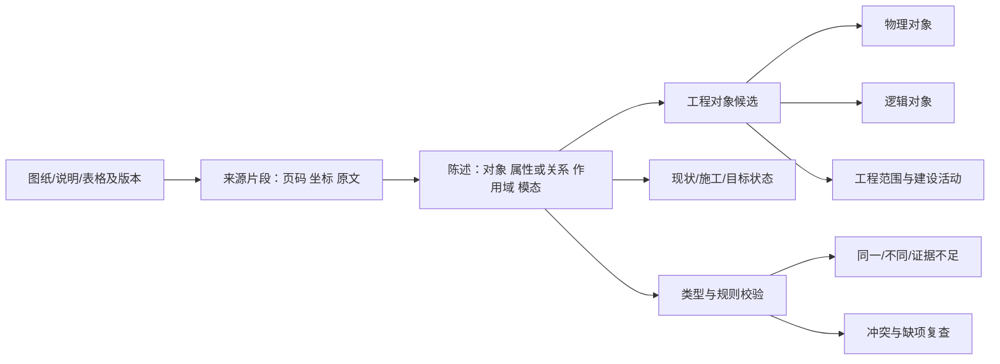

# 通信与ICT工程通用本体 v0.3

## 结论与适用范围

采用“通用工程内核 + 专业扩展 + 来源证据与判定”架构。通用性来自对象层次、关系类型和适用范围的稳定定义，不来自某一份业务表的列名，也不来自型号或站名词典。

本次盘点一批工程图纸已用本地 OCR 逐页读取，保留原生文字、原图、OCR 和坐标。对典型说明、纤芯说明及ICT改造正文作了内容核对。读取不等于完成逐页语义抽取或专家审图。新增资料覆盖多种电力通信场景。

135个新增页面中有20组渲染完全相同的单页/合订本对应，重复出现20页，按渲染计为115个不同页面。保留两种文件来源，但不增加实体数量，也不把重复页面当成两份独立支持证据。其他近似图纸、不同修订页暂不自动判为重复。

这是基于当前电力通信与ICT资料的可扩展工程本体，不是声称适用于所有行业的标准本体。尚未对齐外部行业标准，也未引入图数据库、向量模型或新模型下载。

## 一、对象、状态、证据各自承担什么

“图纸表达”是独立类型，不是物理设备。某个型号也是独立的规格对象，不是一台设备。一个施工动作可以作用于多个对象；同一个设备可跨阶段持续存在，不能把每个状态都当作新设备。

陈述携带三个独立维度：

- **表达性质**：原文事实陈述、设计要求、数量期望、推导结论。说明中的“需配置”不等于已建成。
- **工程作用域**：项目、责任分包/配套工程、工程分期、施工阶段、临时性、文档修订和明确生效时间。
- **证据状态**：候选、相互支持、冲突、否定、人工确认。模型不能自行获得人工确认状态。

“现状/施工/目标”“一期/二期”“永久/临时”分别保存。临时业务可以是本次设计明确交付的目标，不能简单将“临时”归为施工过程；同样，一期不等于现状、二期不等于目标。

## 二、六个专业模块

配置中包含36个类型（含抽象父类）、28种关系、29种属性、15条带适用条件和反例的规则。

| 模块 | 主要对象 | 必须区分的概念 |
|---|---|---|
| 工程范围与建设 | 项目、责任范围、建设活动、设计要求、数量期望、材料表条目 | 图中出现/本工程负责；新增量/目标总量/采购量 |
| 场所与设备 | 站点、建筑、房间、机柜、槽位、设备、板卡、端口、型号、接口规格 | 机构/地点；型号/实例；槽位/端口；接口/速率 |
| 通信传输 | 网络、平面、物理缆段、纤芯集合、接续点、敷设路径、光路、业务、通道 | 实体缆段/纤芯资源通路；光路/主备路由；业务终点/中途节点 |
| ICT与安全 | 安全分区、软件组件、部署实例、功能角色、冗余组 | 网络平面/安全区；服务器/部署；型号/业务角色 |
| 电源与接地 | 电源系统、供电回路、接地点，以及设备/端口 | 两路独立电源/两个设备；电压/电流/容量/后备时间 |
| 证据表达 | 图纸表达、来源片段、陈述、身份判断和复查记录 | 重复表达/独立实例；说明要求/实物状态；OCR读数/确认事实 |

证据片段、陈述和作用域使用独立数据结构，不把它们伪装成设备节点。类型采用稳定英文ID和中文名称；型号、站名、厂商不写进类型枚举。

## 三、关键关系不是一条通用“连接”

| 关系 | 示例 | 约束 |
|---|---|---|
| `instance_of` | 设备实例 → OSN2500型号 | 型号不能充当设备端口的父实例 |
| `located_in` | 设备 → 机柜 → 房间 | 安装位置不等于所属安全区 |
| `participates_in` / `in_security_zone` | 设备 → 网络/平面；设备 → II区 | 两类目标不互换 |
| `part_of` | 槽位 → 设备；纤芯集合 → 物理缆段 | 编号在所属对象内解释 |
| `physical_end` / `transport_end` / `business_end` | 缆段端点、光路端点、业务端点 | 支持端点角色；不默认只有两个端点 |
| `traverses` | 电路经过站点、设备等 | 路径顺序和主备分支单独保存 |
| `uses_resource` / `splices` | 电路使用纤芯；接续点连接资源 | 不从数量推测实际纤芯编号 |
| `carried_by` | 通道 → 光路/专用纤芯/运营商服务 | 允许专芯和复用方式，不都强行经过SDH光路 |
| `performs_role` / `deployed_on` | 设备承担鉴权角色；软件部署于主机 | 同型号不同角色不能默认合并 |
| `supplied_by` / `grounded_to` | 设备供电与接地 | 供电线、网络线、接地线是不同关系 |
| `acts_on` / `responsible_package` | 扩容动作作用于对侧设备，由配套工程负责 | 不能把对侧存量设备记成本工程新增 |

通道的多端、保护套数、A/B口、回次、传输平面是身份与连接的限定信息。第一版不强加“一条业务只有A/Z两端”的通用约束，T接保护等情况使用多条带角色的端点关系。

## 四、新样例如何推动本体设计

六个有原图、OCR片段和位置的建模示例位于 `outputs/ontology_discovery/examples/`。它们由本次分析整理，用于检查表达能力和规则，不是4B模型的自动抽取结果，也不会被生产识别脚本读取。

1. **项目G**：48芯ADSS、24芯资源集合、T接点熔接分别表示。原文“形成24芯光缆”需要结合物理路由与纤芯图解释，不能直接改写上游48芯缆段规格。未给出芯号时不猜1—24。
2. **项目I**：某地区10G华为网与某地区10G华为主城网均使用OSN2500。至少保留两个设备候选以及不同网络关系，不能以同站同型号合并。
3. **项目H**：纤芯说明同时出现设备#6槽位与OPGW01的1、2芯，以及保护所用71、72芯。这些编号具有不同所属对象，不能混为端口号。
4. **项目F**：说明明确“2M通道（FE接口）”。2M属于通道速率，FE属于接口规格，不推导业务为100M。
5. **项目E**：说明既描述对侧扩容，又指出对侧设备由配套工程负责。对象存在、施工动作、工程责任必须分开。
6. **鉴权改造**：安全II/III区独立于网络平面；同型号MODEL-X出现在不同功能角色；“新增3台”和“目标2主2备”分别表达，不能自动补造1台现有设备。说明、机柜图及材料表的具体型号差异保留待核对。

## 五、说明正文如何进入本体

第一步按版面生成段落候选，保留OCR阅读顺序、原始行ID和区域；遇到列变化、标题和明显段落间隔则分开。第二步为每段选择可能涉及的专业模块，仅提供相关类型、属性、关系与约束。第三步才由模型提出有来源的对象与陈述，随后进行类型、数值、作用域及关系校验。

例如“利用现有机柜安装新增鉴权设备，设备由现有UPS供电”应提出：

- 机柜候选，现状状态陈述。
- 鉴权设备的建设/部署动作，目标状态陈述。
- 设备安装于机柜、由UPS供电的候选关系。
- UPS的现状陈述。

不能给整段统一贴“新建”标签，也不能因为“利用”二字将新增设备标为利旧。

**当前已完成段落任务准备与类型校验，尚未完成第三步的通用模型抽取。** 六份说明正文的119个段落候选任务已保存，任务明确标为未执行。段落划分仍是版面候选，可能把长句拆开；表格不得直接沿OCR线性文本拼接成关系，需另做表格行列解析。

原有识别入口已接入版本化本体引用和任务计划输出；原先的11类业务图是兼容投影，仍标为legacy projection，不能冒充完整通用图谱。既有字段表继续导出，尚未自动迁移全部旧候选为严格声明包。

## 六、怎样比较与确认

先确认对象身份，再比较同一属性。文档修订、责任范围、阶段或身份未明确时返回证据不足。不同数量口径、不同工程分期、不同表达性质先解释为作用域差异。网络速率与业务速率属于不同维度，不进入数值冲突比较。

统一单位只进行有明确量纲的数值换算，例如2.5Gbit/s与2500Mbit/s可相互支持。`2×2M`等复合表达不直接压平成一条4M业务；原文保存，分别核对通道数量和每路速率。FE不能装进数值带宽字段。型号前缀、后缀、V2/V3/V5和OCR异读均保留，不作无依据纠正。

只有经明确归属的实例标识才可支持身份确认。名称相近、型号相同、两端相同、空间邻近均不足以合并。人工确认与已核实身份键必须记录确认者；来源相同或相同渲染的重复页不增加独立支持票数。

## 七、实现入口与验收

- `config/engineering-ontology.json`：类型、关系、属性、作用域、规则与模块目录。
- `config/engineering-statements.schema.json`：工程声明包JSON Schema。
- `scripts/engineering_ontology.py`：类型/引用/数值/单位/来源/推导依赖校验，陈述比较与身份判断。
- `scripts/ontology_extraction.py`：段落候选和按模块约束的抽取任务。
- `engineering/ontology-task-plan.json`：普通项目运行中新增的说明任务计划，尚未执行通用语义抽取。
- `outputs/ontology_discovery/review.html`：样例依据、本体目录和实现范围。

验收分为三层：本体能否正确表达已读案例；程序能否拒绝已知类型/范围错误；模型能否从未参与开发的图纸中正确抽出这些陈述。本次完成前两层的第一版，不能将其解释成第三层准确率。

后续应先标注少量段落—对象—关系金标准，测试上下文错误传播、误合并和漏项发现，再扩大自动抽取；不需要先训练额外向量模型或搭建图数据库。新增的六组资料已经参与本体设计，之后不能再称为独立留出测试集。
